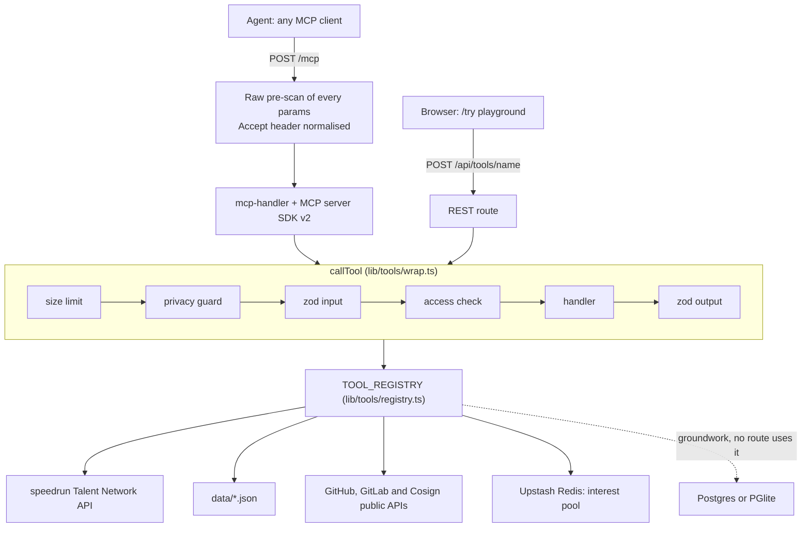

cleared is one Next.js 16 app (App Router, TypeScript strict) deployed on Vercel. It serves the MCP endpoint, a REST endpoint for the playground, and the web pages. There is no separate worker service.

## MCP transport

**Available.** `app/mcp/route.ts` mounts the server at `/mcp` with `mcp-handler` over `@modelcontextprotocol/server` v2, using Streamable HTTP. The transport is stateless: it assigns no session id, answers `POST` and `OPTIONS`, and answers `GET` with 405.

Three things happen before the SDK sees a request:

1. **Raw pre-scan.** The route parses the JSON-RPC body and runs the privacy guard over every message's `params`. The SDK drops unknown keys while it validates, so a later scan would never see an extra argument like `ssn`.
2. **Accept normalisation.** A missing or narrow `Accept` header is rewritten to accept both JSON and SSE, instead of being refused with 406, for agents that write their own client.
3. **CORS.** `mcp-handler` adds no CORS headers, so the route sets them for browser-based clients.

## The shared tool core

**Available.** Every tool is a `ToolDef`: a name, title, description, annotations, zod input and output schemas, and a handler. `lib/tools/registry.ts` holds the one list of 16 tools. Both routes call `callTool`, so the MCP endpoint and the playground cannot drift apart.

`callTool` runs in a fixed order: input size limit (20,000 bytes by default), privacy guard on the raw input, zod validation, access check, handler, output validation. Every successful result lists `ignoredInputKeys`. A failed output check returns a generic error and logs the tool name, never the body. The public tools return `pii_cui_rejected`, `invalid_input`, `upstream_error`, `not_found` or `internal_error`.

**Groundwork.** `callTool` also takes an optional caller context, per-tool `access`, and five pipeline error codes (`unauthenticated`, `forbidden`, `conflict`, `gate_blocked`, `rate_limited`). Only the disabled pipeline stubs declare non-public access, so no served tool uses them. The privacy guard is described in [Privacy and safety](/privacy-and-safety).

## Data sources and caching

| Source | Used by | Caching and limits |
| --- | --- | --- |
| speedrun Talent Network public API (`/api/v1`) | search, rubrics, previews, briefs, guides | Next data cache, 300 s. Each attempt 6 s; at most 3 attempts; retries on 429 and 5xx inside one deadline. Sends `source=cleared`. |
| `data/rules.json`, `data/timelines.json` | `explain_rule`, `estimate_timeline` | Bundled with the app. Each source has a checked date. |
| GitHub and GitLab public REST APIs, Cosign public directory | `verify_evidence` | GitHub and GitLab cached 600 s, Cosign 60 s. `GITHUB_TOKEN` raises GitHub's limit. |
| Upstash Redis | the anonymous interest pool | In memory when no credentials are set. |

Roles come only from live postings in the Talent Network, so generated briefs, previews and guides are built only from the public posting.

## Database

**Groundwork.** The schema and its tests exist, but no route or served tool opens the database.

- **Schema.** 34 tables in `lib/db/schema/*`, with 54 Postgres enums generated from `lib/pipeline/vocab.ts`. Drizzle ORM, migrations in `drizzle/`.
- **Tenancy.** Every employer-owned table carries `org_id`, and child rows use composite foreign keys `(org_id, parent_id)`, so a row cannot point at another employer's parent.
- **Row-level security.** Enabled and forced on 32 tables. Every scoped transaction (`lib/db/tx.ts`) runs `SET LOCAL ROLE clearance_app`, a role with no superuser, no `BYPASSRLS` and no ownership.
- **Append-only audit log.** The app role has no `UPDATE` or `DELETE` grant on `audit_event`, and a trigger refuses both for every role. The one exception is a delete inside the retention purge function, `purge_audit_events`.
- **Embedded Postgres.** Without `DATABASE_URL`, the app uses PGlite under `.data/pglite`, and each test file gets a fresh in-memory database. On Vercel, a missing `DATABASE_URL` is an error, never a silent PGlite.

Not yet checked on a managed Postgres: creating the app role, and `SET LOCAL ROLE` behind a transaction-mode pooler.

A daily cron route, `GET /api/cron/tick`, needs `Authorization: Bearer $CRON_SECRET`. Every job in it is disabled, so it runs nothing yet.

## Testing

| Suite | Command | What it covers |
| --- | --- | --- |
| Unit | `pnpm test` | Every tool, the guard (including red-team cases), data integrity, and the database: migrations, row-level security across two employers, the append-only audit log. No network or account needed. |
| Protocol | `MCP_URL=… pnpm test:protocol` | The official MCP client against a running server. |
| End to end | `pnpm test:e2e` | Playwright against a production build, with axe accessibility checks. |
| Links | `pnpm linkcheck` | Every cited source URL resolves. |

`pnpm verify` runs lint, typecheck, unit tests and the link check. CI (`.github/workflows/ci.yml`) runs them on every push to `main` and every pull request, then the protocol, end-to-end and Lighthouse checks against a production build. `CONTRIBUTING.md` covers setup and how to propose a change.
