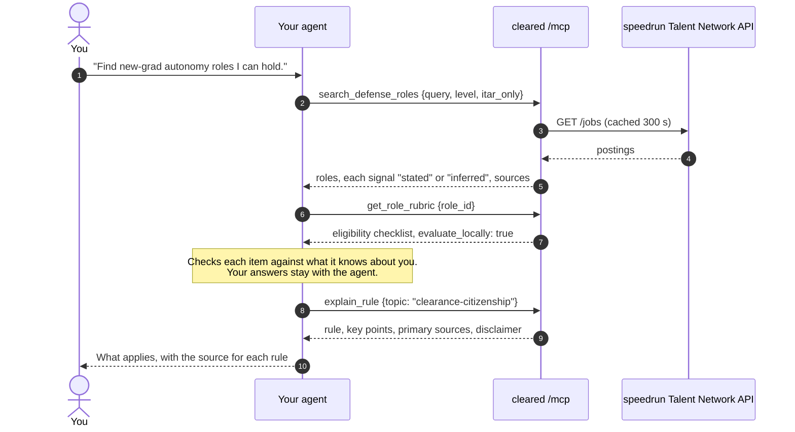

cleared is a connector: a Model Context Protocol (MCP) server your agent reaches over Streamable HTTP. You add it once, and your agent decides when to call its tools. There is nothing to install and no account.

## Your agent and the server

**Available.** The server knows the postings, the rules and the timelines. Your agent knows you. Each keeps to its side.

| Your agent | The cleared server |
| --- | --- |
| Knows who you are, your status, your history | Knows the postings, the rules, the timelines |
| Evaluates checklists against what it knows about you | Returns checklists, rules and templates, marked `evaluate_locally: true` |
| Fills in templates locally, then shows you the result | Returns the template, never the filled-in values |
| Asks you before it shares anything | Refuses identifiers on every input, whatever the agent sends |

`get_role_rubric`, `readiness_brief` and `prepare_consented_card` work this way. For `prepare_consented_card`, the agent sends the names of the fields you approved, such as `headline` and `github_username`, never their values.

## The order of the checks

Each check applies only when the posting states or implies it:

1. **Immigration and work authorisation.** Does the posting require U.S. citizenship or U.S.-person status, or say no visa sponsorship is available? `get_role_rubric` turns each signal into a question for your agent.
2. **Export control.** Is the role likely covered by ITAR? `explain_rule` with `itar-us-person` or `deemed-export` gives the rule and the regulation.
3. **Clearance eligibility.** Does the role require a clearance, and at what level? `explain_rule` with `clearance-citizenship` gives the citizenship rule, and `estimate_timeline` gives published processing times.
4. **Fit and a trial of the work.** `run_job_preview`, `build_trial_assessment`, `fit_debrief` and `readiness_brief` let you try the job and prepare.

Immigration comes first because it decides the others. A U.S. security clearance requires U.S. citizenship; a green card meets ITAR's U.S.-person test but not that rule.

When you decide to apply, `get_role_rubric`, `readiness_brief`, `fit_debrief` and `prepare_consented_card` return the posting's own application page as `howToApply`. You apply there yourself.

## Stated or inferred

`search_defense_roles` reads each posting and reports requirement signals: citizenship, U.S.-person status, sponsorship, clearance level and export control. Each signal carries a `basis`:

- **stated**: it comes with a verbatim quote from the posting.
- **inferred**: a pattern match on the posting, such as a clearance implied by the work. Your agent should confirm it with the employer.

The parsing is in `lib/speedrun/infer.ts`. It is location-aware: a posting in Sydney that asks for an Australian clearance does not get the U.S.-person flag.

## Every rule has a source

Rules are records in `data/rules.json`, each with a summary, key points and sources, and each source with the date it was last checked. Your agent can quote the rule and link the regulation instead of paraphrasing export-control law from memory. [Rules and sources](/rules-and-sources) lists the topics.

## How the agent learns the workflow

MCP has prompts, but some clients, including Grok Bot, grok.com and the Muse app, do not show them. So the server sends `instructions` with its `initialize` reply (`lib/server-instructions.ts`). They tell the agent to:

- Start with `search_defense_roles`, because its `roles[].id` is the `role_id` every other role tool takes.
- Evaluate rubrics privately, and never send names, contact details, ID numbers, dates of birth or clearance records.
- Treat a green card as meeting the ITAR U.S.-person test but not the citizenship rule for a clearance.
- Call `contribute_anonymous_signal` only after the person agrees, every time.

The four MCP prompts (`check_my_eligibility`, `prep_for_role`, `preview_the_job`, `share_intro_card`) carry the same flows for clients that do show prompts.

## Annotations

Every tool declares MCP annotations. Fifteen are read-only. `contribute_anonymous_signal` declares `readOnlyHint: false` because it adds a record to a shared pool. Some agents run read-only tools without asking first, so the flag has to match what the tool does.

## Nothing scores a person

**Available.** No tool scores or ranks a person.

- `get_role_rubric` and `readiness_brief` return checklists for your own agent to evaluate.
- `fit_debrief` returns a summary template and questions, never a score.
- `generate_interview_guide` gives a hiring team's own panel structured questions and answer anchors, built from the posting. It takes no candidate input.

In the designed pipeline, AI would label evidence and a named person would make every decision. That is **not built yet**; see the [Roadmap](/roadmap).
