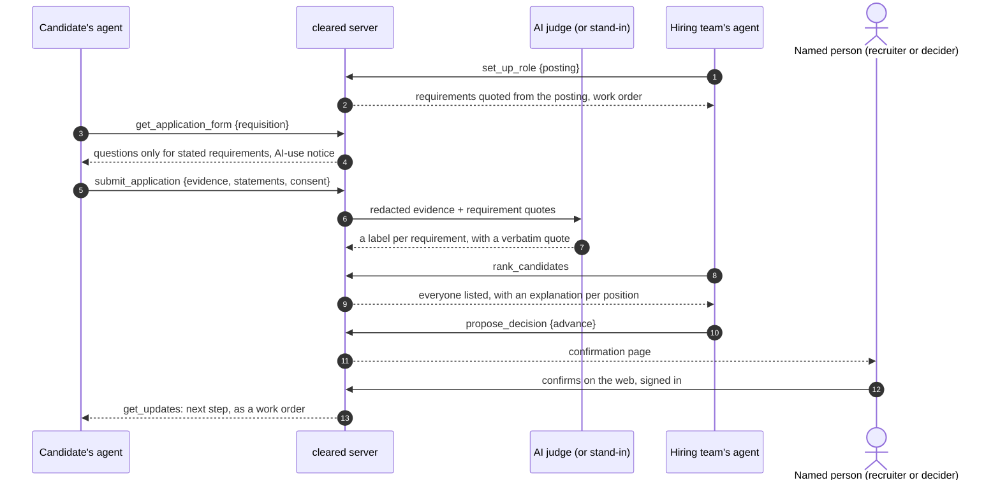

Everything on this page is **not built yet** unless it says **Groundwork**. No tool a client can call today uses any of it. What works today is in the [Introduction](/) and the [Tools reference](/reference/tools).

## The designed pipeline

**Not built yet.** The candidate and a hiring team would each connect their own agent with a personal access token. The server would hold the application between them, run the AI judging, and record every step. A named person would confirm every decision on a web page, signed in.

There is no form for a person to fill in. `get_application_form` is a working name for the call that tells the candidate's agent what a role asks for. The agent answers from what it knows, the candidate approves, and the submission goes to the hiring side.

## How the design keeps people deciding

- **Agents propose, a person confirms.** Any selection decision, rescinding an offer, proceeding after a background check or starting adverse action would be a named person's own act, confirmed on a signed-in web page. No request made with a bearer token could write a decision, an offer acceptance or an adverse-action step.
- **AI judges evidence, not people.** The judge would read evidence with names, emails, links and company names removed, and return one label per requirement from a closed list (`clearly_meets`, `meets`, `partly_meets`, `not_shown`, `cannot_judge`) with a verbatim quote that code checks. A deterministic stand-in would run without a model key.
- **Ranking orders, it never filters.** Everyone is listed. There is no cut-off and no "recommended reject".
- **A person can always override, or judge alone.** A candidate who declines AI use would be judged by people only.
- **Every result ends with a work order**: who does what next, and which tool to call after. A work order never contains another person's contact details.
- **Legal gates are code.** No background check before a written conditional offer, no clearance step before the candidate's written acceptance, and at least five business days between adverse-action notices.

## What exists in the code

**Groundwork.** Built and tested, not used by any served tool or route:

- The Postgres schema (34 tables), row-level security forced on 32 of them, an append-only audit log and scoped transactions. See [Architecture](/architecture#database).
- The work-order schema and renderer (`lib/workorder/*`).
- `callTool`'s caller context, access check and pipeline error codes.
- Twelve pipeline tool stubs in `lib/tools/pipeline/*`: input schemas only, `enabled: false`, left out of the registry. They are listed at the end of the [Tools reference](/reference/tools).
- A daily cron route whose jobs are all disabled.

**Available**, from the same work: eight `explain_rule` topics for the steps after an offer, the recruiter guide at `/docs/recruiter`, and an interest pool that no longer collects citizenship status.

## Build slices

| Slice | What it builds | Status |
| --- | --- | --- |
| S1 | Foundation: schema, row-level security, audit log, stubs | Groundwork |
| S15a | Pre-employment rule topics, the recruiter guide, the pool without citizenship | Available |
| S2 | Identity and mail: one-time sign-in links, personal access tokens for agents, a mail outbox, work orders on public tools | Not built yet |
| S3 | Employer organisations and member roles | Not built yet |
| S4 | Roles opened from live postings, and what each asks of the candidate's agent | Not built yet |
| S5 | Applications and candidate profiles | Not built yet |
| S6 | AI judging, with a deterministic stand-in | Not built yet |
| S7 | Ranking: a pure, explainable function | Not built yet |
| S8 | Requests for more evidence, and work samples | Not built yet |
| S9 | Interviews and ratings | Not built yet |
| S10 | Proposals, decisions and web confirmation pages | Not built yet |
| S11 | Offers | Not built yet |
| S12 | Background-check tracking through a provider interface, and adverse action | Not built yet |
| S13 | Pre-employment and day-one checklist, including Form I-9 and E-Verify deadlines | Not built yet |
| S14 | Retention, legal holds, data requests | Not built yet |
| S15b | Rewrite of the privacy page, README and instructions; three tools removed | Not built yet |
| S16 | End-to-end journeys and red-team tests | Not built yet |

When S15b ships, `prepare_consented_card` would be replaced by `submit_application`, and `prepare_signed_attestation` and `verify_signed_attestation` by statements affirmed through the account. The public tools that involve no person would keep working with no sign-in.

## Before the pipeline can run

It needs a managed Postgres database, a mail service, an AI model key and a background-check provider account, each set as an environment variable; legal review of AI-in-hiring duties and employer terms; and a dry run on real agent accounts.
